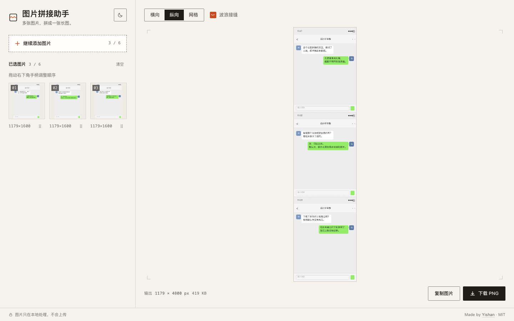

# Image Stitch Assistant

> [**中文版**](./README.zh-CN.md) · [English](./README.md)

Stitch multiple images into a single long picture, right in your browser — no uploads, no installs.



## Features

- **Multiple input methods** — drag & drop, file picker, or clipboard paste; fully keyboard-accessible upload and reordering.
- **Layouts** — vertical, horizontal, auto grid, plus fixed-cell 2×2 / 1+2 / 1+3 presets; free layouts support the wave seam, fixed presets use straight joins.
- **Export controls** — PNG / JPEG / WebP, quality for the lossy formats, and size presets: original (safe defaults), long-image mode, 4096 px longest edge, 1080 px wide, or a custom edge.
- **Long-image mode** — relaxes the longest edge to 16,384 px and the budget to 20 MP. On browsers that support an 18 MP canvas (Chrome/desktop) six phone screenshots keep their native width; if the runtime probe detects WebKit's ~16 MP canvas ceiling, the export falls back to 16 MP and the result bar says so.
- **Layout controls** — outer margin, spacing, background (transparent / paper / white / ink / custom), rounded corners for straight seams, and three wave-seam strengths. Small images are never upscaled — they centre at their original size.
- **Per-image edits** — select a thumbnail to rotate 90°, flip horizontally/vertically, switch between contain and cover, pick a focus point inside a fixed grid, or reset that image; edits are undoable and restored with the session.
- **Visible output** — live format, pixel dimensions and file size, with a note when the output had to be scaled down.
- **Long-image preview** — switch between fit-to-stage and fit-to-width; long results then scroll vertically inside the stage.
- **Session restore** — images, order and every setting are stored locally in IndexedDB and restored after a refresh/crash; a settings-sheet button clears the local session.
- **Shortcuts & undo** — `Cmd/Ctrl+Z`, `Shift+Cmd/Ctrl+Z`, `Cmd/Ctrl+S`, `Delete` for the selected image; slider bursts coalesce into one history step.
- **Themes** — follows your OS until you pick a side; your choice is remembered, and switching doesn't cascade transitions.
- **100% local & private** — images are processed only in the browser Canvas and are never uploaded to any server.
- **Safety limits** — each file must be under 10 MiB with an aspect ratio of at most 30:1; decode budgets and output pixels are capped (8192 px longest edge by default, 16,384 px in long-image mode, 20 MP overall), and the output is downscaled with a visible note when a cap is hit. Large canvases are capability-probed first so lower-limit devices never export a blank image.

## Tech Stack

- React 19 + Vite 7
- [@dnd-kit](https://dndkit.com/) for drag-to-reorder
- Plain Canvas API for stitching and encoding
- Playwright for end-to-end regression (upload/layouts/export/long image/privacy/session)
- Node.js ≥ 20.19 (see `.nvmrc`)

## Local Development

```bash
nvm use
npm ci
npm run dev
```

Common checks:

```bash
npm test        # run unit tests (node --test)
npm run lint    # run ESLint
npm run build   # production build into dist/
npm run preview # preview the production build
npm run e2e     # Playwright end-to-end (run npx playwright install chromium once)
```

## Deployment

The default build targets a site served from the root path. If you deploy to a repository sub-path such as GitHub Pages, provide the path at build time:

```bash
VITE_BASE_PATH=/repository-name/ npm run build
```

For static hosting platforms, set the build command to `npm run build` and the publish directory to `dist`.

## Project Structure

- `src/lib/imageIntake.js` — image validation, count limits, and Object URL lifecycle.
- `src/lib/imageTransform.js` — per-image rotate/flip/fit/focus normalisation and immutable updates.
- `src/lib/stitchLayout.js` — geometry and seam calculations for vertical/horizontal/auto-grid/fixed-grid presets.
- `src/lib/stitchRenderer.js` — Canvas drawing, export specs/limits, encoding and decode cache.
- `src/lib/sessionStore.js` — local session persistence (IndexedDB).
- `src/lib/history.js` — undo/redo history.
- `src/components/` — upload, sortable preview, settings sheet, stage and result interactions.
- `e2e/` — Playwright specs, fixtures and helpers.
- `docs/DESIGN.md` — visual and interaction rules (tokens, states, motion).
- `docs/ROADMAP.md` — capability roadmap; `docs/TODO.md` — P0–P2 checklist.

## License

[MIT](./LICENSE) © Yishan
