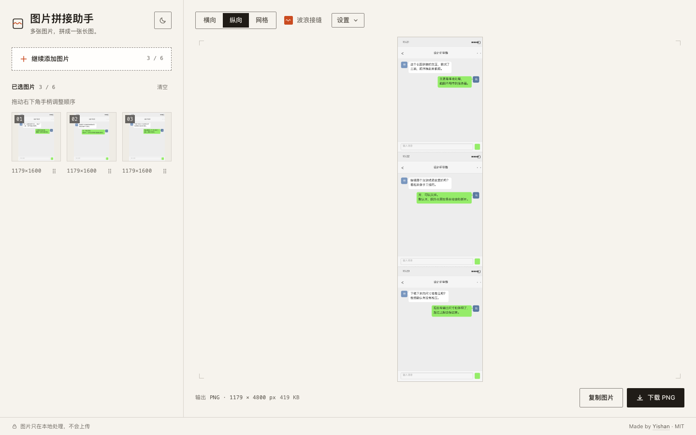

# 图片拼接助手

> [**English**](./README.md) · [中文版](./README.zh-CN.md)

在浏览器本地将多张图片无缝拼接成一张长图，无需上传、无需安装。



## 功能特性

- **多种输入方式** — 支持拖拽、文件选择和剪贴板粘贴；上传与排序完全支持键盘操作。
- **三种布局** — 纵向、横向和网格，可选在图片之间加入波浪接缝。
- **导出可控** — PNG / JPEG / WebP，JPEG / WebP 可调质量；尺寸预设包含原始尺寸（安全上限）、长图模式、长边 4096 px、宽 1080 px 与自定义长边。
- **长图模式** — 放松最长边到 16,384 px、上限 2,000 万像素。支持 18 MP 画布的浏览器（Chrome / 桌面）下，6 张手机截图可保持原始宽度；运行时检测到 WebKit 约 16 MP 的画布上限时会自动回退到 16 MP，并在结果条标注。
- **版式参数** — 外边距、图片间距、背景色（透明 / 纸色 / 白 / 墨 / 自定义）、直边模式的圆角，以及三档波浪接缝强度；小图不会被放大，会按原始尺寸居中留白。
- **输出信息可见** — 实时显示成品格式、像素尺寸与文件体积；触及上限时会标注「已按上限缩放」。
- **主题切换** — 默认跟随系统，手动切换后会记住你的选择；切换时不触发过渡闪烁。
- **100% 本地、保护隐私** — 图片仅在浏览器 Canvas 中处理，绝不会上传到任何服务器。
- **安全限制** — 单张图片不超过 10 MiB，宽高比不超过 30:1；单图解码总量与输出像素都有上限（默认最长边 8192 px，长图模式 16,384 px，总计 2,000 万像素），超出时会等比缩小并提示；大画布会先探测浏览器能力，避免在画布上限较低的设备上导出空白图。

## 技术栈

- React 19 + Vite 7
- [@dnd-kit](https://dndkit.com/) 实现拖拽排序
- 原生 Canvas API 完成拼接与 PNG 编码
- Node.js ≥ 20.19（见 `.nvmrc`）

## 本地开发

```bash
nvm use
npm ci
npm run dev
```

常用检查：

```bash
npm test        # 运行单元测试（node --test）
npm run lint    # 运行 ESLint
npm run build   # 生产构建到 dist/
npm run preview # 预览生产构建
```

## 部署

默认构建面向根路径站点。若部署到 GitHub Pages 等仓库子路径，请在构建时提供路径：

```bash
VITE_BASE_PATH=/repository-name/ npm run build
```

静态托管平台应将构建命令设为 `npm run build`，发布目录设为 `dist`。

## 项目结构

- `src/lib/imageIntake.js`：图片验证、数量限制和 Object URL 生命周期。
- `src/lib/stitchLayout.js`：三种布局的几何计算与 seam 数据。
- `src/lib/stitchRenderer.js`：Canvas 绘制、输出限额和 PNG 编码。
- `src/components/`：上传、排序预览、设置和结果交互。
- `docs/DESIGN.md`：视觉与交互规则（token、状态、动效）。
- `docs/ROADMAP.md`：能力路线图与优先级。

## 开源协议

[MIT](./LICENSE) © Yishan
